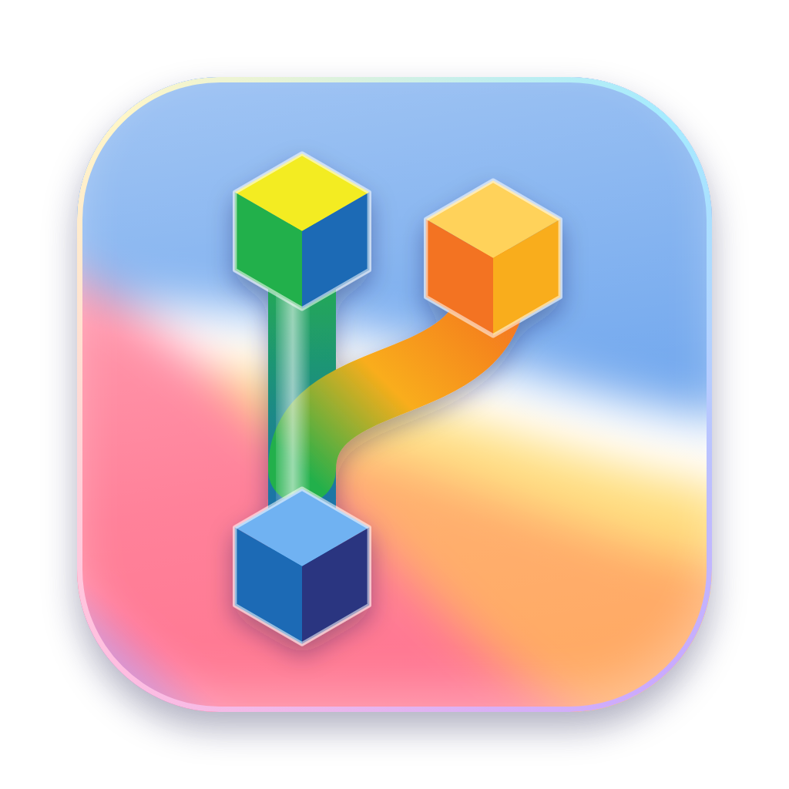

<p align="center"></p>

# GIT Watcher

A macOS app that watches every git repository in a folder and lets you commit, push, rebase and fix CI from
one window of Liquid Glass cards. AI writes commit messages, and an AI agent steps in when a commit, rebase,
push or CI run fails. An MCP server gives AI agents (Claude Code, Codex, Cursor) the same git tools.

## Features

- **One card per repository.** Changed files by kind in a ring, added and deleted lines, last commit,
  ahead/behind, and GitHub Actions progress in percent with time left while a run is going (estimated from
  the median of the last successful runs of the same workflow). Up to five columns; fewer as the window
  narrows.
- **Commit and push from the card.** Write the message yourself or press ✨ to let AI write it. Buttons that
  have nothing to do are disabled.
- **More in ⋯:** use the AI agent, fetch, pull with rebase, rebase on `origin/main`, sync, stash and stash pop,
  continue or abort a rebase, fix CI with AI, open in VS Code, Finder or Terminal, change the icon, hide the repo.
- **Repository page.** Click the eye or the ring: changed files with checkboxes, history as a timeline, and a
  diff of any working file or any file of any commit. Right-click a file to discard its change (new files go to
  the Trash).
- **AI helper.** One button writes messages, commits, fetches, rebases and pushes every repository with work
  waiting. When a step fails, the AI agent takes over that repository and finishes the job.
- **Fix CI.** When a GitHub Actions run fails, the app reads the failed log with `gh` and the AI agent fixes
  the cause, commits and pushes. It never force-pushes, never uses `--no-verify` and never disables tests.
  **Fix all CI** at the top does the same for every failed repository, one after another.
- **Success is checked, not assumed.** After an agent finishes, the app looks at the repository itself (clean,
  nothing waiting to push, a new commit for a CI fix) before it reports a repository as done.
- **Folder picker.** Choose any folder; repositories are found in all its subfolders (build and dependency
  folders are skipped). Recent folders are one click away.
- **Hide repositories** you do not care about and show them again from Settings or the folder menu.
- **Icons.** Each repository shows its own app icon or logo when it has one in a known place, otherwise a
  coloured glyph from its name, or any image you choose.
- **English or Icelandic.** English by default; switch in Settings and the whole window changes at once.

## AI providers

Pick the provider in Settings (⚙︎):

| Provider | How it signs in | Typical speed |
|----------|-----------------|---------------|
| Claude Code | your Claude subscription (`claude auth login`) | a few seconds |
| Codex | your ChatGPT subscription (`codex login`) | up to a minute |
| Anthropic API | API key | 1–5 seconds |
| OpenAI API | API key | 1–5 seconds |
| DeepSeek API | API key | 1–5 seconds |
| Google Gemini API | API key | 1–5 seconds |
| Any OpenAI-compatible API (OpenRouter, Ollama, Groq…) | API key and base URL | depends |

API keys are stored in the macOS login keychain (service `GIT Watcher AI`), never in a file. The AI agent that
fixes problems runs Claude Code or Codex in the repository, because it has to run git itself.

## Install

Requires macOS, Flutter 3.47+, git and, for CI, the GitHub CLI (`gh auth login`).

```bash
make install        # raises the version, builds the app into /Applications and the MCP server into ~/.local/bin
make register-mcp   # registers the MCP server with Claude Code and Codex
```

Every `make install` raises the patch version and build number (`tool/bump_version.sh`), shown next to the
title and in Settings.

## MCP server for AI agents

`git-watcher-mcp` speaks the Model Context Protocol over stdio and exposes the repositories of the watched
folder (the same folder and settings as the app, from `~/.uteamup/gitwatcher.json`):

| Tool | What it does |
|------|--------------|
| `list_repos` | every repository with branch, changed files, ahead/behind and last commit |
| `repo_status` | changed files with added/deleted lines |
| `file_diff` | diff of an uncommitted file, or of a file in a commit |
| `repo_log`, `commit_details` | history and the files of one commit |
| `ci_status` | GitHub Actions state and progress |
| `commit` | commits only the given paths (other staged work is left alone) |
| `push`, `pull_rebase`, `fetch` | never force |

Add it to any MCP client by pointing it at `~/.local/bin/git-watcher-mcp`.

## Development

```bash
make run            # debug build
make analyze        # flutter analyze + dart analyze
make test           # widget/unit tests and the git engine tests (uses real git in a temp folder)
make icon           # re-render the app icon and in-app logo from design/app_icon.html
```

- `packages/git_watcher_core` is pure Dart: git, CI, AI providers, config and the MCP server.
- `lib/` is the Flutter app: Liquid Glass widgets in `lib/ui`, state in `lib/state`, screens in `lib/pages`.
- Text lives in `lib/l10n/app_en.arb` (the template) and `lib/l10n/app_is.arb`; `flutter gen-l10n` (run by
  every build) turns them into `AppLocalizations`. Add a key to both files when you add text.
- `packages/git_watcher_core/tool/` has manual smoke checks for the AI providers and the agent.
